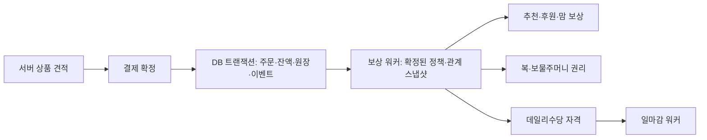

# JMUSDT 쇼핑몰·마케팅·USDT 모으기·조직도 개발 계획

작성일: 2026-10-28. 상태: **저장소 코드 조사와 개발 설계 완료, 기능 구현 전**.

## 1. 요구사항과 조사 범위

사용자 요청은 다음 네 기능을 기존 프로젝트에서 가져와 JMUSDT에 통합하는 것이다.

1. 어드민 상품·상세페이지·가격 등록 → 지갑의 쇼핑몰 메뉴에서 구매.
2. 구매를 기준으로 추천리워드, 후원리워드, 맘리워드, 복주머니, 보물주머니, 데일리수당 작동.
3. 기존 969 트론 지갑과 같은 USDT 지갑 모으기.
4. `viagra` 프로젝트와 같은 조직도.

사용자는 조사 중 **969 트론 지갑 = `ibnetsoft/wallet`**임을 확인했다. 원본 내부의 369 표기와 URC969 브랜드는 동일 저장소의 서로 다른 명칭이다.

GitHub에서 실제 소스를 내려받아 확인했다. 아래 커밋에 고정된 파일을 기준으로 하며, 운영 DB의 마이그레이션 적용 여부나 원본 서비스의 실거래 성공을 검증한 것은 아니다. 원본 `.env`, 키 파일, 회원 CSV·감사 데이터는 분석·이식 대상에서 제외했다.

| 저장소 | 검토 기준 | 용도 |
| --- | --- | --- |
| [wallet](https://github.com/ibnetsoft/wallet/tree/eb041f4674d6f92cd01be9e6541b8ac7913c60d2) | `eb041f4674d6f92cd01be9e6541b8ac7913c60d2` | 패키지 구매, 추천·후원·맘 정산, 일마감, TRC20 모으기 |
| [viagra](https://github.com/ibnetsoft/viagra/tree/a67538223795703c3d19aec5b0036605228ec4d4) | `a67538223795703c3d19aec5b0036605228ec4d4` | 조직도·배치, 상품 구매 흐름 |
| JMUSDT | 조사 시 로컬 소스 | Supabase 인증, bigint USDT 원장, 서명 서비스, TRON 워커, PWA·어드민 |

추가로 `vcoinwallet`, `Referral`의 파일 구조를 확인했지만 이번 기능의 주 이식 대상으로 선정하지 않았다. 다운로드한 조사 사본은 Git에서 제외되는 `artifacts/research/`에 있다.

## 2. 결론과 이식 원칙

JMUSDT를 유지하면서 상품·주문·보상·조직 관계를 모듈로 추가한다. 원본 프로젝트 전체 또는 SQL 전체를 덮어쓰지 않는다.

- `wallet`의 머신 구매 이벤트를 **쇼핑몰 주문 결제 이벤트**로 전환한다. 게임 회차·베팅·자동 참여는 가져오지 않는다.
- `viagra`의 조직도 조작과 조회 기능을 옮기되, PV 금액과 원본 회원·로그인 시스템은 JMUSDT에 연결하지 않는다.
- 쇼핑 결제는 앱 내부 USDT 원장에서 처리한다. 구매할 때마다 온체인 출금을 실행하지 않는다.
- 모으기는 회원 입금 주소의 온체인 자산을 회사 주소로 옮기는 수탁 작업이다. **회원 앱 잔액이나 쇼핑 결제액을 차감하는 작업이 아니다.**
- 사용자·관리자 임시 계정, 비밀번호, 원본 mnemonic·회사 개인키는 코드와 문서에 포함하지 않는다.
- 이번 단계는 설계 문서만 추가한다. 운영 테이블·상품·보상률·워커·자금 이동을 변경하지 않는다.

## 3. 코드에서 확인된 기능과 차이

### 3.1 쇼핑몰

`wallet/apps/user-web/src/lib/products.ts`는 100/500/1,000 USDT 고정 패키지를 정의한다. 구매 API `apps/user-web/src/app/api/package/purchase/route.ts`는 한 DB 트랜잭션에서 잔액 차감, JADE·URC·HONGBAO 지급, 머신 생성, `settle_machine_purchase` 호출을 수행한다. **일반 상품 관리자 CMS·상세페이지 편집기는 이 구조만으로 충족되지 않는다.**

`viagra/src/components/member-shop.tsx`는 상품 목록, 최초/재구매 가격, 구매 확인, 부족 잔액 안내를 제공한다. `src/app/actions.ts`의 `buyProduct`와 `supabase/migrations/20260910103130_member_shop_and_organization.sql`의 `buy_product`는 서버 상품 가격과 주문 스냅샷·요청 UUID를 사용한다. `20260914042802_repeat_purchase_price.sql`도 함께 확인해야 한다. 결제 단위가 PV이고 첫 구매/재구매의 원본 보상이 결합돼 있으므로 구매 SQL을 그대로 사용하지 않는다.

**이식:** 상품 카드·구매 확인·서버 가격·주문 멱등성 개념. **신규:** 상품 CMS, 이미지·상세 콘텐츠, USDT 결제, 재고·배송·환불, JMUSDT 보상 연동.

### 3.2 마케팅 플랜

최신 `wallet/supabase/migrations/20260830093000_update_referral_bonus_rate_to_30pct.sql`의 `settle_machine_purchase`가 직접 보상의 핵심이다.

| 요청 항목 | 원본에서 확인한 동작 | JMUSDT 적용 판단 |
| --- | --- | --- |
| 추천리워드 | 구매금액 30% → `recommender_id`; 수령자 잔여 지급 한도 적용 | 주문의 보상 기준액에 대한 설정형 비율로 전환. 30%는 원본 값이며 신규 확정값이 아님 |
| 후원리워드 | 구매금액 10% → `sponsor_id`; 잔여 한도 적용 | 후원 관계 스냅샷과 결합. 비율·자격·한도 확정 필요 |
| 맘리워드 | 실제 지급된 후원금액을 후원 수령자의 직추천인에게 1회 100% 매칭. 해당 수령자의 한도도 적용 | 원본 최신 SQL 기준으로 구현. 후원 명목액을 매칭하지 않음 |
| 복주머니 | `HONGBAO` 보유 수량과 패키지 구매 지급 확인. 100/500/1,000 패키지에 0/1/3개 | 명칭 연결 후보. 지급·사용·소멸·USDT 교환 가능 여부는 별도 정책 필요 |
| 보물주머니 | 동일 한글 명칭의 완성된 지급·개봉 흐름 미확인. `BAO`, `JADE`, 최탄 티켓 등은 존재 | 어떤 원본 자산/기능을 뜻하는지 미확정. 임의로 BAO 또는 최탄에 대응시키지 않음 |
| 데일리수당 | `daily_rate=1.2` 설정은 있으나, 조회한 일마감 워커는 직접보상 보정·직급 갱신·최탄 분배를 실행. 일반 회원에게 1.2%를 매일 지급하는 완성 경로는 미확인 | 지급 대상·기준·기간·한도·재원 확정 후 신규 엔진으로 구현 |

원본 패키지별 지급 한도는 구매액 대비 200% / 250% / 300%다. `credit_capped_bonus`는 오래된 구매부터 남은 한도를 소비한다. 새 쇼핑몰의 모든 구매가 동일한 수익 한도를 추가한다고 가정하면 안 된다. 상품/플랜별 별도 `reward_entitlements`로 설계한다.

**원본 버전 충돌:** 일마감 워커 파일에 과거의 맘 2회 지급 helper가 남아 있지만 `processReferralAndFosterBonusesDeprecated`는 이름 그대로 구경로다. 현재 직접보상 경로는 DB의 `settle_machine_purchase`를 호출한다. 과거 helper를 이식해 맘 보상을 이중 지급하지 않는다.

원본 최탄은 일매출 10% 풀을 회원별 티켓 비율로 분배한다. 패키지별 티켓은 0/1/3이다. 현재 소스의 직급 보상 지급 함수는 비활성이다. 최탄·직급을 사용자 요청의 보물주머니·데일리수당과 동일하다고 단정하지 않는다.

원본 일마감은 UTC 16:00(북경 00:00)에 예약되지만 집계에는 `CURRENT_DATE`와 UTC 날짜 문자열이 혼재한다. JMUSDT는 확정된 정산 시간대와 `[시작, 종료)` 구간을 저장하고 명시적으로 집계한다. 제안 기본은 `Asia/Seoul`이며 최종 정책 확인 대상이다.

### 3.3 USDT 모으기

원본 `wallet/docs/trc20-usdt-sweep.md`와 `apps/admin/src/lib/trc20-sweep*.ts`, `Trc20SweepPanel.tsx`, 관련 API·마이그레이션을 확인했다.

확인된 업무 흐름:

1. 회원 주소별 **실제 온체인 USDT 양수 잔액** 조회. RPC 실패·시간 초과는 0이 아닌 미확인으로 표시.
2. 회사 수신 주소, 수량, 회원/회사 TRX, 가스 보충 상한, fee limit 미리보기.
3. 서버 HMAC 검토본과 5분 만료, 운영자의 단건 또는 목록 일괄 승인.
4. 필요시 회사 TRX로 회원 주소의 가스를 보충 → solid receipt 확인 → USDT 이동.
5. DB에 서명 payload/TX ID를 먼저 보존 → 브로드캐스트 → 공식 토큰의 정확한 Transfer 로그 확인.
6. 승인된 요청만 서버 워커가 진행. 브라우저 종료 후에도 계속 실행. 원본 스케줄러는 15초 간격, UI는 5초 갱신.
7. 불명확하거나 만료된 TX는 원래 TX를 조사하고 새 서명을 자동 발행하지 않음. 멱등키·lease·회사 signer lock 사용.

원본 설정의 TRX 보충 상한 25 TRX, 회사 최소 보유 50 TRX는 소스의 운영 값이다. JMUSDT의 확정값으로 자동 채택하지 않는다. 에너지/대역폭·실제 가격을 반영한 정책으로 설정한다.

JMUSDT에는 이미 `sweep_jobs`, `workers/tron.ts:sweep()`와 어드민 회수 요청이 있다. 기존 워커를 확장해 이식한다. 현재 요청/서명/브로드캐스트 상태만으로는 원본의 TRX 보충·견적·일괄 진행 UI를 충족하지 못한다.

원본은 서버 DB 설정의 회사 개인키·마스터 mnemonic을 사용하고 mainnet RPC를 고정한다. JMUSDT는 **기존 격리 수탁·서명 서비스**를 유지하고 Nile/mainnet을 명시적으로 분리한다. 웹 앱 DB에 개인키를 복사하지 않는다. TRX 보충 서명에는 native TRX transfer 지원이 별도로 필요하다.

2026-10-28 원본에 추가된 회사 지갑 외부 송금(건당 잔액의 90% 제한)은 별도 기능이며 이번 ‘모으기’에 자동 포함하지 않는다.

### 3.4 조직도

`viagra/src/components/member-organization.tsx`, `src/app/actions.ts:loadOrganizationTree/loadUnplacedMembers/placeReferredMember` 및 조직도 SQL을 확인했다.

- 추천 계보 / 후원 계보 전환.
- 본인·하위 회원으로 내려가기, 경로 되돌아가기·초기화.
- 깊이: 전체 / 3 / 5 / 10 / 15 / 20단계.
- 확대·축소(15%~250%), 드래그 이동, 모바일 핀치, 전체화면, 루트 중앙 정렬.
- 회원 노드: 이름, ID/회원코드, 가입일, 매출PV 등. 상세 SQL은 전화번호도 포함하므로 JMUSDT에서는 마스킹·권한 정책 필요.
- 직접 추천한 미배치 정상 회원 선택 → 자신의 후원 산하 L/R 빈 자리에 배치 → 확인 모달.
- 순환·타 조직 배치·사용 중인 자리·재배치 차단, 잠금과 감사 기록.
- 일반 회원은 본인 산하만 조회. 관리자는 별도 권한 API로 전체 조회.

원본 최신 username 노출 변경은 `20260918042811_organization_tree_username.sql`을 포함해 확인한다. PV 표시는 JMUSDT의 구매 실적 USDT 또는 별도로 확정한 실적 점수로 교체한다.

**중요한 모델 충돌:** `wallet`은 추천 활성화 순번 3/6/9마다 추천 상위 1/2/3세대로 후원인을 자동 이동시키며, 두 자리에 국한되지 않는다. `viagra`는 후원인당 L/R 두 자리 수동 배치다. 같은 `sponsor_id`에 두 규칙을 동시에 적용할 수 없다.

권고안은 `viagra`와 동일한 **추천 관계 + L/R 후원 관계**를 기본으로 두고 `wallet`의 추천·후원·맘 보상 계산을 이 관계에 적용하는 것이다. 3·6·9 자동 이동도 반드시 필요하다면 별도 ‘보상 후원 관계’를 두거나, L/R 빈자리 탐색 규칙을 추가 확정해야 한다. 어느 쪽도 사용자 확정 전 자동 적용하지 않는다.

## 4. 사용자·관리자 화면 설계

### 사용자 PWA

기존 검정·빨강 디자인을 유지한다. 모바일 하단 메뉴는 내 지갑 / 쇼핑몰 / 리워드 / 더보기로 구성하고 거래내역·조직도·설정은 더보기에서도 접근하게 하는 안을 제안한다. 기존 송금 버튼의 접근성은 유지한다.

- `/shop`: 카테고리·검색·판매중 상품 목록.
- `/shop/[slug]`: 이미지, 상품명, USDT 가격, 상세 콘텐츠, 구매 수량, 재고·배송 안내.
- `/shop/checkout`: 배송지(실물일 때), 서버 견적, 사용 가능 잔액, 최종 결제 확인.
- `/orders`, `/orders/[id]`: 결제·배송·취소/환불 상태와 보상 상태.
- `/rewards`: 여섯 항목별 지급/대기/취소 내역, 누적액, 지급 한도, 복·보물주머니 보유량.
- `/organization`: `viagra`의 모드·깊이·줌·이동·배치 기능을 유지한 조직도.

### 웹 어드민

- 상품: 등록/수정/판매중지, 카테고리·정렬, 대표/상세 이미지, 가격, 재고, 배송 유형, 보상 적용 여부.
- 상세페이지: 안전한 블록 편집(텍스트·이미지·제목·표), 미리보기·초안·발행 버전. 임의 script/iframe/이벤트 핸들러 금지.
- 주문: 회원/상품/기간 검색, 배송 입력, 취소·환불 승인, 원장·보상 추적.
- 마케팅: 정책 초안/검증/예약 발행, 적용 버전, 대상 상품, 비율·기준액·한도·주머니 지급표, 지급 내역·오류 재처리.
- 조직도: 전체 검색·조회, 미배치 회원, 권한 있는 관계 수정과 변경 사유·영향 미리보기.
- 지갑 모으기: 잔액 보유 주소, TRX 견적, 단건/일괄 검토·승인, 단계별 TX, 일시정지·실패 조사.

기존 `adminConsole` 권한과 `SUPER_ADMIN + AAL2` 자금 권한을 유지한다. 상품 편집과 자금 이동·보상정책 발행 권한을 분리하고, 구체 권한표는 구현 시 확장한다.

## 5. 결제·보상 처리 계약

결제 확정 시점에만 구매 이벤트를 발생시킨다. 상품 조회·장바구니·버튼 클릭만으로 보상을 지급하지 않는다.

### 결제

1. 상품의 발행 버전, 수량·재고, 차단 여부·잔액을 서버에서 검증.
2. 동일 요청 키에 동일 구매 내용만 재사용 허용. 내용이 달라지면 충돌 처리.
3. 계정·재고 행을 일정한 순서로 잠가 초과구매·동시 출금과 이중사용 방지.
4. 주문 가격·배송·보상기준·정책 버전·추천/후원 수령 관계를 스냅샷 저장.
5. 잔액 차감, 주문 확정, 재고 차감, 균형 원장, 보상 outbox를 같은 트랜잭션으로 커밋.
6. 워커 오류 시 주문은 유지하고 보상은 대기/오류 상태로 노출. 고객 결제를 다시 실행하지 않음.

### 보상

- `order_id + order_item_id + policy_version + reward_type + beneficiary + component`로 중복 지급 방지.
- USDT는 기존과 같이 10^-6 단위 bigint. 비율은 정수 bps, 곱셈/나눗셈도 bigint. 자릿수 미만은 내림하고 잔여액 처리 기록.
- 장바구니 혼합 상품은 주문항목별로 정책 스냅샷 저장. 배송비·할인·세금 포함 여부를 보상 기준에서 명시.
- 지급 재원은 판매대금의 배분액 또는 회사 보상 예산 계정으로 명시. 단순 balance 증가로 보상을 생성하지 않음.
- 추천·후원·맘 수령자가 동일인일 때 항목 합산 허용 여부, 본인 보상, 차단/미자격/루트 누락, 한도 소진 처리 규칙 필요.
- 맘 계산은 `후원 실제 지급액 × 매칭률` 후 수령자의 한도 적용. 후원이 한도로 6 USDT만 지급됐다면 100% 맘의 기준은 6 USDT.
- 보상 정책 발행 이후 기존 주문을 새 비율로 재계산하지 않는다. 관계 변경도 과거 지급을 소급 변경하지 않는다.
- 복·보물주머니는 정책 확정 전까지 기능 플래그를 끈다. 수량성 자산이라면 USDT와 분리해 정수 수량 원장 사용. 랜덤 개봉은 확정 요구사항이 아니므로 임의 구현하지 않는다.
- 데일리는 `정산일 + 권리 + 회원 + 정책버전` unique, 일정 기준 시간대·구간·지급기간·누락일 재처리 지원.

### 취소·환불

원 거래·원장은 수정/삭제하지 않고 환불·보상 취소를 보정 거래로 기록한다. 부분 환불은 주문항목·수량별 분배 근거를 저장한다. 이미 사용한 주머니·보상, 출금된 보상은 단순 음수 잔액으로 만들지 않는다. 환불 부채/미수 계정·향후 상계 또는 지급 보류 정책을 먼저 확정한다. 주문 1건 재시도가 환불이나 회수를 중복 실행하지 않아야 한다.

## 6. 데이터 모델 초안

아래는 논리 설계다. 운영 DDL이 아니며 기존 `db/schema.sql`에 즉시 실행하지 않는다. 실제 구현 단계에서 증분 마이그레이션을 작성한다.

| 영역 | 제안 테이블 | 주요 필드·제약 |
| --- | --- | --- |
| 상품 | `products`, `product_versions`, `product_media`, `categories` | SKU/slug unique, 가격 units, 판매상태, 상세 발행본, 재고, 버전 |
| 주문 | `orders`, `order_items`, `refunds` | 회원, 요청키 unique, 금액/정책 스냅샷, 상태, 배송, 원장 거래 참조 |
| 조직 | `member_relationships`, `relationship_changes` | 회원 unique, referrer, sponsor, L/R; sponsor+position 조건부 unique; 자기참조·순환 방지 |
| 정책 | `marketing_plans`, `marketing_plan_versions`, `product_reward_rules` | 불변 발행본, 적용기간, bps, 기준액, 자격·한도·주머니 규칙 |
| 지급 권리 | `reward_entitlements` | 구매 원천, 총한도/사용한도, 기간, 티켓·수량, 활성/소진 상태 |
| 보상 | `reward_events`, `reward_postings`, `settlement_runs` | outbox lease, 수령관계 스냅샷, 중복키, 산정/실지급/미지급 사유, 기준일 |
| 주머니 | `benefit_balances`, `benefit_entries` | 종류별 수량, 발급·사용·취소 이력; USDT와 분리 |
| 모으기 | 기존 `sweep_jobs` 확장 + `sweep_batches`, `sweep_quotes`, `sweep_attempts` | 회사 주소·network·contract·수량·견적·승인자·TRX/USDT TX·lease·재시도 |

기존 `transactions.kind`는 deposit/transfer_in/transfer_out/withdrawal만 허용하므로 purchase/refund/reward/reward_reversal 확장이 필요하다. 금융 enum뿐 아니라 거래내역 필터·상세·CSV·대시보드 합계도 함께 변경한다.

기존 `journal`은 `transaction_id`를 필수로 참조하며 batch 합계 0과 불변성을 강제한다. 모든 쇼핑·보상·환불도 거래 레코드와 균형 batch를 만들고 상업 계정 이름을 명시한다. 주머니에는 별도 불변 수량 원장을 둔다. 수탁 모으기는 고객 채무를 건드리지 않고 온체인 이동 이력으로 관리한다.

회원/부모/주문 외래키 인덱스, 정산 대기 partial 인덱스, `FOR UPDATE SKIP LOCKED` 기반 작업 청크와 lease를 사용한다. 모든 노출 테이블은 RLS, 회원은 본인 주문·보상만, 조직은 본인 산하만 허용한다. 상품 미발행본·배송정보·전화번호·서명 payload는 공개 조회하지 않는다. 원본의 무제한 전체 조직 조회는 UI 선택지는 유지하되 서버 예산·노드 제한과 점진 조회를 적용한다.

## 7. API 초안

모든 POST/PATCH는 기존 Origin 검사와 검증된 사용자 세션을 사용한다. 브라우저가 보내는 회원 ID·가격·보상액은 권한/금액 근거로 사용하지 않는다.

| 그룹 | 경로 예시 | 동작 |
| --- | --- | --- |
| 상품 | `GET /api/shop/products`, `GET /api/shop/products/[slug]` | 판매 발행본 조회 |
| 결제 | `POST /api/shop/quote`, `POST /api/orders` | 견적/서버 검증 및 원장 결제 |
| 주문 | `GET /api/orders`, `GET /api/orders/[id]` | 소유 주문 조회 |
| 환불 | `POST /api/orders/[id]/refund-request` | 환불 신청. 실제 환불은 승인 절차 |
| 리워드 | `GET /api/rewards`, `GET /api/rewards/benefits` | 지급내역·한도·주머니 수량 |
| 조직 | `GET /api/organization`, `GET /api/organization/unplaced`, `POST /api/organization/placements` | 추천/후원 조회·미배치·배치 |
| 관리 | `/api/admin/products`, `/api/admin/orders`, `/api/admin/marketing` | 상품 발행·주문·정책 관리 |
| 모으기 | `/api/admin/sweeps/balances`, `/quotes`, `/batches`, `/[id]` | 서버 잔액·견적·승인·상태 |

## 8. USDT 모으기 상태 머신

`requested → quoted → approved → gas_signing → gas_broadcast → gas_confirmed → usdt_signing → usdt_broadcast → confirmed`를 기본으로 한다. 가스가 충분하면 gas 단계를 생략한다. 별도로 paused/rejected/failed/reconcile_required 상태를 둔다.

- 견적 또는 원본 주소·수량·회사 주소 변경 시 재검토. 일괄 승인도 주소별 수량·상한을 고정한 manifest를 승인한다.
- 네트워크/토큰/주소 소유와 derivation 검증은 수탁 서비스에서 재검사.
- source별 활성 요청 unique와 회사 gas signer 직렬화. 단건/일괄/cron이 같은 요청을 중복 실행하지 못하도록 한다.
- RPC 호출 동안 긴 DB 트랜잭션을 유지하지 않는 durable worker 구조. DB claim → 외부 작업 → 결과 저장으로 구분.
- 서명 bytes를 브로드캐스트 전에 저장. 불명확한 응답은 같은 bytes/TX만 조회·재전송. 만료 후 자동 새 거래 금지.
- USDT 완료는 공식 contract, from, to, amount, solid receipt 전부 일치할 때만 기록.
- 모으기 전후 회원 `balances.available/reserved` 불변, 온체인 수탁 총액 대사, 실제 TRX 비용은 회사 운영비로 기록.
- `TRON_BROADCAST_ENABLED=false` 기본값과 Nile 검증을 유지한다. 스케줄 설치가 승인되지 않은 신규 모으기 요청을 만들어서는 안 된다.

## 9. 개발 단계와 완료 기준

| 단계 | 산출물 | 완료 조건 |
| --- | --- | --- |
| 0 정책 고정 | 보상·조직·상품 정책표, 모으기 운영표 | 아래 미확정 항목 결정; 미정 보상 비활성 |
| 1 기반 | 증분 DB, 계정·주문·outbox·관계 모델, 권한 | 기존 입출금·송금 회귀 통과, 원장/멱등성 검증 |
| 2 쇼핑몰 | 상품 CMS·상세·주문·내부 USDT 결제·환불 | 어드민 등록 상품을 PWA에서 결제, 중복결제·초과재고 방지 |
| 3 조직도 | viagra 기능 이식·조회·배치·모바일 제스처 | 산하 접근·순환·자리 경합·재배치 제한 검증 |
| 4 마케팅 | 정책버전·추천/후원/맘·주머니·데일리 | 주문별/정산일별 1회 지급, cap·환불 보정·예산 대사 |
| 5 모으기 | 원본 수준 패널·TRX 보충·durable worker | Nile에서 가스→USDT 확정, 재시도 중복 없음, 회원 잔액 불변 |
| 6 통합 | 운영 가이드·지표·대사·배포 | 구매→보상→조직 실적→환불 전체 재현, 롤백·복구 검증 |

테스트에는 1 USDT=1,000,000 units 정밀도, 동시 결제/출금, 동일 요청 다른 payload, 품절 경합, 정책 변경 직후 구매, 추천/후원 동일인, 한도 경계, 맘의 실제 후원액 매칭, KST 자정/누락일 재실행, 부분 환불, 이미 사용한 주머니, 타 회원 조직 ID 접근, L/R 동시 배치, 가스 영수증 지연·서명 후 프로세스 종료·만료 TX를 포함한다. 이 단계의 오프라인 검증과 실제 Nile 전송 검증을 구분한다.

## 10. 구현 전에 확정할 정책

| 번호 | 결정 항목 | 제안/현재 상태 |
| --- | --- | --- |
| P1 | 추천/후원 조직 | viagra L/R 기본 권고. wallet 3·6·9 자동 이동 동시 적용 여부 미정 |
| P2 | 구매 시점 | 내부 USDT 결제 확정으로 이벤트 발생; 보상 즉시지급 vs 구매확정까지 보류 미정 |
| P3 | 보상 기준·비율 | 원본 30/10/후원 실지급 100%는 참고값. 판매가/순매출/별도 기준액 선택 필요 |
| P4 | 자격·한도 | 구매 시 활성화 기준, 첫 구매/재구매, cap 추가량, 소진/초과분 처리 미정 |
| P5 | 복주머니 | HONGBAO와 동일한지, 상품별 수량·사용·소멸·환불 회수 미정 |
| P6 | 보물주머니 | 원본 대응 기능/자산·계산식·사용처 미정 |
| P7 | 데일리수당 | 원금/실적/풀 기준, 비율·기간·지급일·재원·시간대·한도 포함 여부 미정 |
| P8 | 쇼핑 운영 | 실물/디지털, 배송·재고·옵션, 배송비·부분환불, 최초/재구매 가격 여부 미정 |
| P9 | 모으기 정책 | 회사 수신 주소·Nile/mainnet·TRX 상한·최소 reserve·실행 권한·수탁 배포 필요 |

정책이 미정이어도 상품 CMS, 주문 모델, 조직도 조회/조작, 모으기 미리보기 개발은 진행할 수 있다. 다만 보상 지급·관계 자동 변경·실제 체인 전송은 확정된 정책과 검증 이후 활성화한다.

## 11. 주요 원본 파일

링크는 조사 커밋에 고정했다. 후속 개발자는 오래된 함수 설명보다 최종 마이그레이션의 실제 호출 경로를 우선한다.

- [wallet 상품 정의](https://github.com/ibnetsoft/wallet/blob/eb041f4674d6f92cd01be9e6541b8ac7913c60d2/apps/user-web/src/lib/products.ts)
- [wallet 패키지 구매](https://github.com/ibnetsoft/wallet/blob/eb041f4674d6f92cd01be9e6541b8ac7913c60d2/apps/user-web/src/app/api/package/purchase/route.ts)
- [wallet 최신 직접 보상 SQL](https://github.com/ibnetsoft/wallet/blob/eb041f4674d6f92cd01be9e6541b8ac7913c60d2/supabase/migrations/20260830093000_update_referral_bonus_rate_to_30pct.sql)
- [wallet 3·6·9 배치와 맘 수정](https://github.com/ibnetsoft/wallet/blob/eb041f4674d6f92cd01be9e6541b8ac7913c60d2/supabase/migrations/20260813152000_fix_369_sponsor_rollup_and_mama_bonus.sql)
- [wallet 지급 한도 함수](https://github.com/ibnetsoft/wallet/blob/eb041f4674d6f92cd01be9e6541b8ac7913c60d2/supabase/migrations/20260813140000_repair_activation_bonus_and_game_entries.sql)
- [wallet 일마감 워커](https://github.com/ibnetsoft/wallet/blob/eb041f4674d6f92cd01be9e6541b8ac7913c60d2/workers/settlement-cron/src/index.ts)
- [wallet TRC20 모으기 운영 설명](https://github.com/ibnetsoft/wallet/blob/eb041f4674d6f92cd01be9e6541b8ac7913c60d2/docs/trc20-usdt-sweep.md)
- [wallet 모으기 worker](https://github.com/ibnetsoft/wallet/blob/eb041f4674d6f92cd01be9e6541b8ac7913c60d2/apps/admin/src/lib/trc20-sweep-worker.ts)
- [wallet 모으기 검증 테스트](https://github.com/ibnetsoft/wallet/blob/eb041f4674d6f92cd01be9e6541b8ac7913c60d2/apps/admin/tests/trc20-sweep.test.cjs)
- [viagra 조직도 UI](https://github.com/ibnetsoft/viagra/blob/a67538223795703c3d19aec5b0036605228ec4d4/src/components/member-organization.tsx)
- [viagra 조직도 조회 깊이 SQL](https://github.com/ibnetsoft/viagra/blob/a67538223795703c3d19aec5b0036605228ec4d4/supabase/migrations/20260916032650_organization_depth_tree.sql)
- [viagra 조직도 username SQL](https://github.com/ibnetsoft/viagra/blob/a67538223795703c3d19aec5b0036605228ec4d4/supabase/migrations/20260918042811_organization_tree_username.sql)
- [viagra 추천 회원 배치 SQL](https://github.com/ibnetsoft/viagra/blob/a67538223795703c3d19aec5b0036605228ec4d4/supabase/migrations/20260914045221_referrer_member_placement.sql)
- [viagra 상품 구매 UI](https://github.com/ibnetsoft/viagra/blob/a67538223795703c3d19aec5b0036605228ec4d4/src/components/member-shop.tsx)
- [viagra 초기 상품·구매 SQL](https://github.com/ibnetsoft/viagra/blob/a67538223795703c3d19aec5b0036605228ec4d4/supabase/migrations/20260910103130_member_shop_and_organization.sql)

원본에서 발견한 `rejectUnauthorized:false`, Number 기반 금융 연산, 구버전 맘 helper, 웹 DB의 개인키 보관, 게임 관련 의존성은 이식하지 않는다. JMUSDT의 검증된 TLS·bigint·불변 원장·서버 권한·격리 서명을 유지한다.
